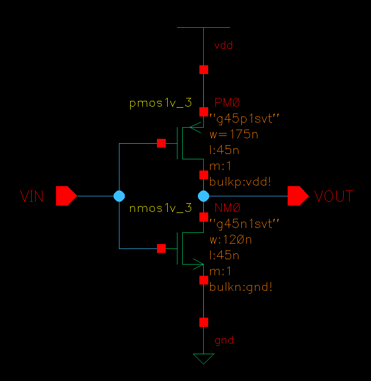
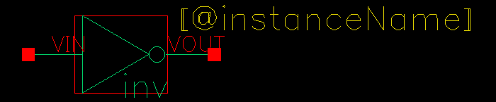
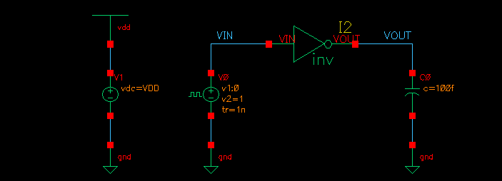
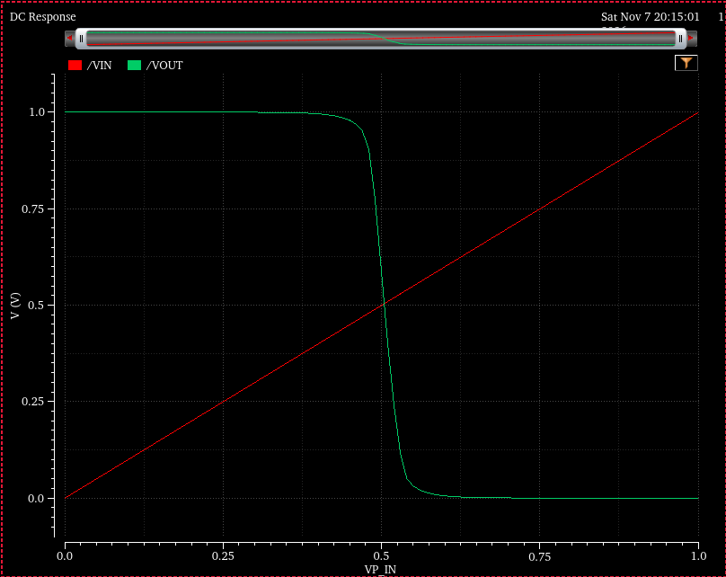
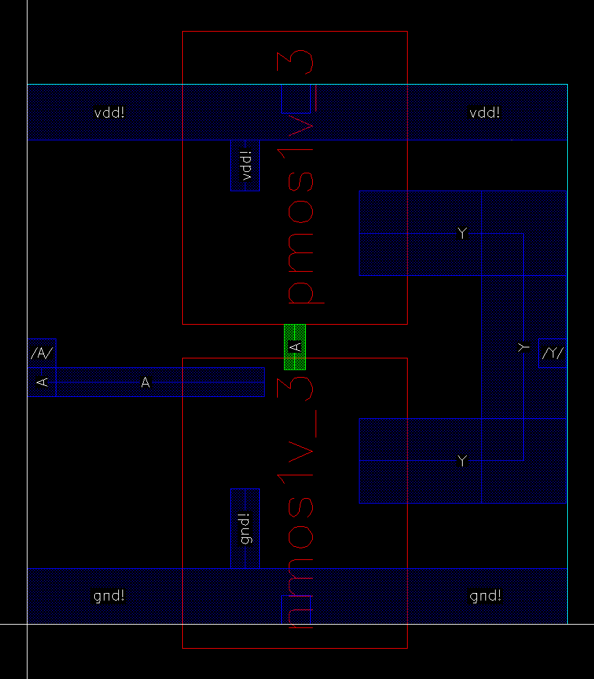

# 45 nm CMOS Inverter in Cadence Virtuoso

This repository contains a complete Cadence Virtuoso implementation of a minimum-size CMOS inverter. The project covers the flow from transistor-level schematic capture through physical layout, verification, parasitic extraction, and post-layout simulation setup.

The design was created with the `gpdk045` 45 nm technology library and uses Cadence Spectre for circuit simulation and Pegasus for physical verification.

## Project highlights

- CMOS inverter schematic and reusable symbol
- Inverter simulation testbench with supply, pulse input, and capacitive load
- DC transfer-characteristic simulation from 0 V to 1 V
- Transient simulation setup with a 200 ns stop time
- Custom transistor layout using Metal 1, poly, active, well, and substrate connections
- Pegasus design-rule checking (DRC)
- Layout-versus-schematic (LVS) verification
- QRC parasitic extraction and an `av_extracted` view for post-layout simulation

## Circuit

The inverter is built from one PMOS pull-up transistor and one NMOS pull-down transistor. Both gates are driven by `VIN`, and their drains are connected at `VOUT`.

| Parameter        |            Value |
| ---------------- | ---------------: |
| Technology       | `gpdk045`, 45 nm |
| Supply voltage   |              1 V |
| PMOS width       |           175 nm |
| NMOS width       |           120 nm |
| Channel length   |            45 nm |
| Load capacitance |           100 fF |





## Testbench and simulation

The testbench instantiates the inverter symbol and drives it with an analog-library `vpulse` source. A 1 V DC source provides the supply, and a 100 fF capacitor is connected from `VOUT` to ground to represent the load.



The local ADE Explorer/Maestro state used for the project includes:

- A transient analysis with a `200n` stop time
- A DC sweep of the input from 0 V to 1 V
- `VIN` and `VOUT` selected as simulation outputs
- Design variables for the NMOS and PMOS widths

The generated Maestro state and simulation history are not included in the public checkout; the portable `oceanScript.ocn` captures the main simulation setup.

The included DC response shows the expected inverter behavior: `VOUT` is high for a low input, transitions near the middle of the 0-1 V input range, and approaches 0 V for a high input.



The standalone OCEAN automation script is included as [`oceanScript.ocn`](oceanScript.ocn). It configures a Spectre DC analysis, sets `W_n = 120 nm` and `W_p = 175 nm`, and plots `/A` and `/Y`.

## Layout

The layout was generated from the verified schematic and then completed manually. The PMOS is placed in the upper region near the `vdd` rail, the NMOS is placed below near `gnd`, the gates are connected to `VIN`, and the joined drains form `VOUT`.



## Physical verification

### DRC

Pegasus DRC was run on the exported `inv` layout. The saved report records:

- 562 DRC rule checks
- 0 DRC results/violations
- 55 original layout geometries

The DRC run was completed successfully. Environment-specific Pegasus logs, rule decks, run directories, and reports are intentionally excluded from the public checkout because they contain machine-specific paths and PDK/tool details.

### LVS

Pegasus LVS was run between the layout and the schematic. The saved result was a clean comparison with no reported ERC results. Raw LVS databases, logs, reports, and run scripts are intentionally excluded from the public checkout for the same portability and privacy reasons.

## Parasitic extraction and post-layout simulation

After LVS, QRC extraction was performed for the inverter layout. The editable Cadence `av_extracted` view is present at:

```text
45_design/inv/av_extracted/
```

This view can be selected in a suitably configured Cadence environment to run the same testbench with extracted parasitic effects included. The generated QRC databases and command files are excluded from the public checkout.

## Repository structure

```text
.
├── 45_design/
│   ├── inv/                 # Inverter schematic, symbol, layout, and av_extracted views
│   └── inv_tb/              # Simulation testbench
├── images/                  # Exported schematic, symbol, layout, testbench, and waveform images
├── cds.lib                 # Cadence library mappings
└── oceanScript.ocn         # Spectre/ADE OCEAN simulation script
```

## Reproducing the project

This repository is intended to be opened in a Cadence environment with access to:

- Cadence Virtuoso/IC23.x and Spectre
- The `gpdk045` 45 nm technology library
- Pegasus DRC/LVS
- Pegasus Quantus/QRC extraction

The committed OpenAccess databases are environment-dependent. The proprietary Cadence tools and `gpdk045` technology files are not included in this repository. Generated DRC/LVS/QRC run outputs and ADE session state are kept out of the public checkout because they contain machine-specific paths and licensing/tool details.

To inspect the design, configure the local PDK paths in `cds.lib`, launch Virtuoso using your Cadence installation's environment setup, and open the `45_design` library. The main cells are:

- `inv/schematic` - transistor-level inverter schematic
- `inv/symbol` - reusable inverter symbol
- `inv/layout` - physical layout
- `inv/av_extracted` - extracted view for post-layout simulation
- `inv_tb/schematic` - simulation testbench
- `oceanScript.ocn` - portable Spectre/ADE OCEAN simulation setup
